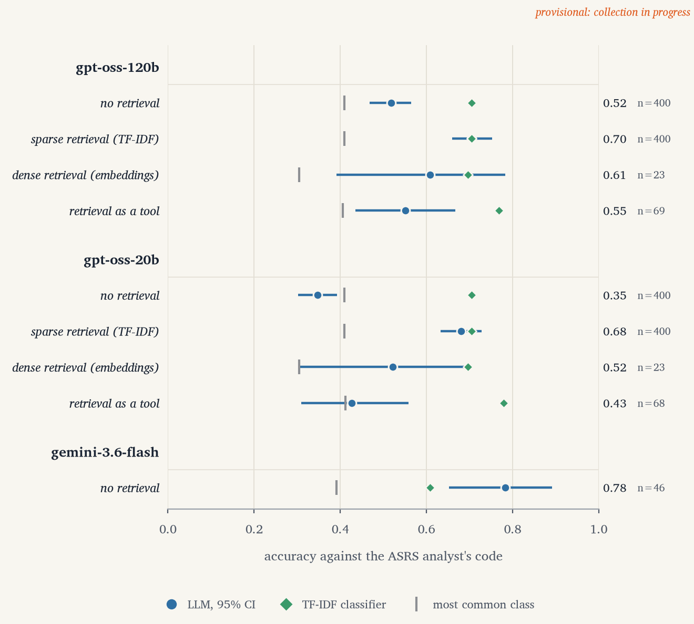
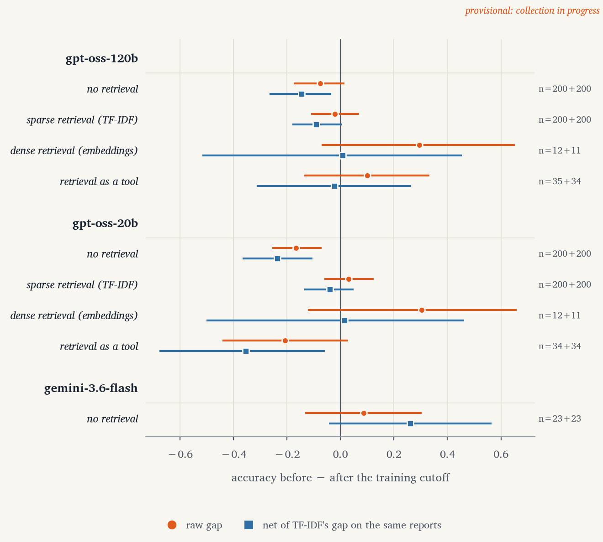
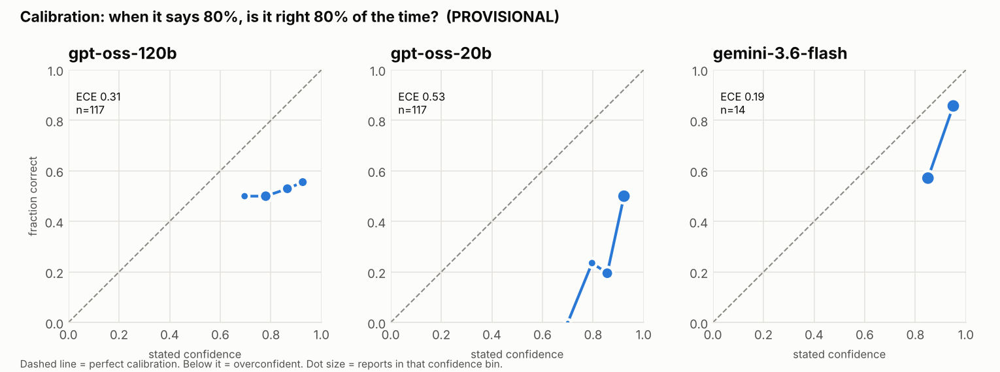

# Do LLMs agree with expert aviation safety coders?

**Live dashboard: [aviation-llm-eval.streamlit.app](https://aviation-llm-eval.streamlit.app/)**

> **Status: collecting data. Every model result below is provisional.** The experiment runs
> daily inside free-tier API limits; the charts, the dashboard and
> [`results/results.json`](results/results.json) regenerate after every run. The baselines are final.

NASA's [Aviation Safety Reporting System](https://asrs.arc.nasa.gov) (ASRS) is a public
database of confidential incident narratives written by pilots, controllers and technicians. ASRS
analysts code each one, including its **Primary Problem**: the single most prominent factor
(Human Factors, Aircraft, Procedure, Weather, and 14 others).

This project asks three LLMs to code the same narratives and measures:

1. **Agreement with the analysts**, against two baselines that cost nothing: always predicting the
   most common category, and a TF-IDF + logistic regression classifier.
2. **Calibration**: when a model says it is 80% sure, is it right 80% of the time?
3. **Memorisation**: is accuracy higher on reports filed *before* the model's training cutoff
   than after it, beyond what the reports' own difficulty explains?
4. **Retrieval**: does showing five similar, already-coded reports change the answer, does it
   matter whether they are found by keywords (TF-IDF) or by sentence embeddings, and will a
   model choose to look them up when offered retrieval as a tool?
5. **Robustness**: do irrelevant changes to the prompt change the answer more often than simply
   asking again does?

## The number to beat

Scored on all 4,985 held-out reports (95% bootstrap CIs):

| Baseline | Accuracy | Macro-F1 | Cohen's κ | ECE |
|---|---|---|---|---|
| Always "Aircraft" (most common class) | 0.343 [0.330, 0.357] | 0.032 | 0.000 | 0.000* |
| TF-IDF + logistic regression | **0.638 [0.624, 0.651]** | **0.369** | **0.528** | 0.101 |

\*The majority baseline states the overall class frequency as its confidence, so it is perfectly
calibrated while being useless. Calibration is reported next to accuracy, never instead of it.

Every LLM number is reported next to both baselines **scored on exactly the same reports**.

*Correction, 10 November:* the TF-IDF baseline was first reported as 0.636. Its optimiser had
stopped short of convergence, which left 29 predictions sensitive to machine-level rounding; the
Docker reproducibility check caught it rebuilding differently on GitHub. Fitted to convergence it
is 0.638. Rebuilt on a clean machine it matches to within 0.001 on every metric; one or two
near-tie predictions can still differ between machines, which CI tolerates up to 0.002.

## Live results (provisional)



**Figure 1.** Accuracy against the ASRS analyst's code, (a) without and (b) with five retrieved,
already-coded similar reports in the prompt. Lines are 95% bootstrap CIs; diamonds and ticks are
the two baselines scored on exactly the same reports.



**Figure 2.** Accuracy before the training cutoff minus after. Circles: raw gap. Squares: gap net
of the TF-IDF baseline's gap on the same reports. n is reports before + after.



**Figure 3.** Reliability diagrams without retrieval; dots sized by reports per confidence bin.
Below the dashed diagonal (shaded) is overconfidence.

### Retrieval quality, before any LLM (final)

Over all 4,985 test reports, how often the 5 retrieved training reports carry the same analyst
code, and the accuracy of simply taking their majority vote
([`results/retrieval_quality.json`](results/retrieval_quality.json)):

| Retriever | Same code among top 5 | 5-NN vote accuracy |
|---|---|---|
| Sparse (TF-IDF) | 0.549 [0.540, 0.559] | 0.644 [0.631, 0.658] |
| Dense (bge-small embeddings) | 0.551 [0.540, 0.560] | 0.635 [0.622, 0.648] |

Dense minus sparse, paired: **+0.001 [−0.006, +0.008]**. On this task, dense embeddings retrieve
no better than keyword matching. Whether the LLMs nonetheless use dense neighbours differently is
what the dense-retrieval condition measures.

Probe, noise-floor, dense-retrieval and tool results appear as those jobs run.

## Design

### Data

- **24,925 ASRS reports**, every month from January 2022 to August 2026, exported from ASRS
  Database Online in date-window batches (the export caps at 5,000) and de-duplicated on report
  number (ACN).
- Frozen in [`data/processed/asrs_reports.csv.gz`](data/processed/asrs_reports.csv.gz) with a fixed
  80/20 stratified train/test split (19,940 / 4,985). Models are only ever evaluated on test
  reports; retrieval examples and the TF-IDF baseline only ever come from train reports.
- Target: Primary Problem. Categories with fewer than 30 reports are folded into "Other" (16
  classes). The models choose from all 18 ASRS values and the same folding is applied to their answers.

### Models and training cutoffs

| Model | Provider | Training cutoff | Source |
|---|---|---|---|
| gpt-oss-120b | Groq | June 2024 | [Model card, §2.4](https://arxiv.org/html/2508.10925): *"Our model has a knowledge cutoff of June 2024."* |
| gpt-oss-20b | Groq | June 2024 | Same model card |
| gemini-3.6-flash | Google | March 2026, but "limited to January 2025" in some domains | [Model card](https://deepmind.google/models/model-cards/gemini-3-6-flash/) |

Gemini's model card gives two dates, so reports from January 2025 to March 2026 are **not
sampled** for it: "before" means before January 2025, "after" means April 2026 onwards. Gemini's
free tier allows 20 requests a day, so it runs the memorisation comparison only, without
retrieval, on 50 reports either side of its cutoff (cut from 200 on 10 November, for schedule reasons, after 14 jobs;
the kept sample is the first 100 jobs of the original plan, so nothing was re-sampled).

### Experiments (frozen plan: [`results/plan.json`](results/plan.json), 3,900 jobs)

| | gpt-oss-120b, gpt-oss-20b | gemini-3.6-flash |
|---|---|---|
| Main: 200 reports before + 200 after cutoff, with and without retrieval | 800 each | — |
| Noise floor: 20 reports × 10 identical repeats | 200 each | — |
| Probes: jargon / label order / padding × 100 reports | 300 each | — |
| Memorisation: 50 before + 50 after, no retrieval | — | 100 |
| *Added 10 Nov:* dense retrieval on the same 400 main reports | 400 each | — |
| *Added 10 Nov:* retrieval as a tool, first 200 main reports (100 + 100) | 200 each | — |

The two added conditions came from a review on 10 November. They are appended after every
original job ([`scripts/extend_plan.py`](scripts/extend_plan.py)), so nothing already planned
moved, and they run on the same reports as the main experiment, so every comparison is paired.

- **Retrieval**: the five nearest *training* reports are shown as their one-line synopsis plus
  the analyst's code (synopses rather than narratives, to fit free-tier token budgets).
  - *Sparse*: TF-IDF cosine similarity over training narratives.
  - *Dense*: cosine similarity between sentence embeddings from
    [`BAAI/bge-small-en-v1.5`](https://huggingface.co/BAAI/bge-small-en-v1.5) (384 dimensions,
    pinned to revision `5c38ec7`), exact search over the ~20,000 training vectors; no approximate
    index is needed at this scale. Neighbours are precomputed by
    [`scripts/build_dense_index.py`](scripts/build_dense_index.py) and committed, so the runner,
    CI and Docker never load the model.
  - *As a tool*: the model is offered `find_similar_reports(k)` (k = 1–5) and decides whether to
    call it. The tool returns exactly what sparse retrieval shows, so the only difference from
    always retrieving is the model's choice. Its use rate is reported with a CI.
- **Probes** change one thing and re-run the same reports: *jargon* spells out 43 aviation
  abbreviations (ATC → air traffic control); *order* reverses the category list; *padding* appends
  a paragraph of irrelevant boilerplate. (ASRS reports are already de-identified, so the usual
  name-anonymisation probe does not apply.)
- **Noise floor**: how often two identical prompts at temperature 0 give different answers. A
  probe only matters if it changes answers more often than that.

### Scoring rules (fixed before the results; also embedded in `results.json`)

- A **refusal** (reply fails the schema twice, the second time with the error fed back) counts as
  **wrong** in accuracy and is excluded from calibration. Refusal and schema-failure rates are
  reported per model.
- **Provider errors** (overload, quota) are not results; those jobs stay pending and the error
  rate is reported as availability.
- **Memorisation** = accuracy before cutoff − accuracy after (different reports: unpaired
  bootstrap). The later reports might simply be harder, so the same gap is computed for the TF-IDF
  baseline on the same reports — it cannot have memorised anything — and subtracted.
- **Retrieval and probe effects** compare the same reports (paired bootstrap).
- All intervals are 95% percentile bootstrap CIs, 2,000 resamples, seed 42.

## How it runs

```
schema.py    Pydantic model for every answer: category, confidence in [0,1], reason
providers.py one OpenAI-compatible client for Groq and Gemini, backoff on 429/5xx
retrieve.py  sparse (TF-IDF) and dense (precomputed embedding) retrieval, training split only
agent.py     retrieve -> classify -> validate -> one retry with the error fed back -> refusal
runner.py    frozen plan, per-model daily budgets in each provider's quota timezone,
             JSONL trace of every call, resumable
report.py    results.json; charts.py the figures; app/dashboard.py the Streamlit view
```

Every call is traced in [`results/traces/`](results/traces/): prompt hash, model version reported
by the provider, tokens, latency, raw reply, parse result, retries.

### Running without me

| Workflow | When | What it does |
|---|---|---|
| [`tests.yml`](.github/workflows/tests.yml) | every push | 82 tests; builds the Docker image on a clean machine and checks the rebuilt baselines match the committed numbers within 0.002 |
| [`daily.yml`](.github/workflows/daily.yml) | daily (09:23 UTC, backup 17:47) | **Collection.** Runs the next jobs in the frozen plan within each model's free quota, rebuilds results and figures, commits |
| [`weekly.yml`](.github/workflows/weekly.yml) | Sundays (11:41 UTC, backup 19:17) | **Monitoring.** For each model whose plan is complete, re-asks a fixed panel of reports it has already answered (40 per gpt-oss model, 15 for Gemini) and compares with its original answers |

Monitoring flags **drift** when a week's agreement with the original answers is clearly below
what the noise floor allows (the 95% CI's upper bound is under the lower bound expected from
identical-prompt disagreement), or when the provider reports a model version not seen in the
original run. That is how a provider silently changing a model behind the same name would show
up. Both workflows commit only when there are new traces; a skipped or repeated run is harmless
because budgets and weekly panels are counted from the committed traces.

## Reproduce

With Docker — rebuilds the baselines, `results.json` and every figure from the committed data
and traces, no API keys needed:

```bash
docker build -t asrs-llm-eval .
docker run --rm -v "$PWD/results:/app/results" asrs-llm-eval
```

Or locally:

```bash
git clone https://github.com/hydrograd/asrs-llm-eval && cd asrs-llm-eval
pip install -e ".[dev]"
pytest                                   # no network or keys needed
python scripts/run_baselines.py          # baselines from the frozen dataset
python scripts/make_report.py            # results.json + figures from the committed traces
export GROQ_API_KEY=... GEMINI_API_KEY=...
python scripts/run_experiment.py --status
python scripts/run_experiment.py         # next batch within today's budgets
python scripts/run_experiment.py --monitor   # this week's drift panel (completed models only)
streamlit run app/dashboard.py
```

The metrics are tested against hand-worked examples, with each expected value derived in a
comment beside it ([`tests/test_metrics.py`](tests/test_metrics.py)).

## Limitations

Written now and kept up to date, not added at the end.

- **The labels are one analyst's judgement.** ASRS does not publish inter-coder agreement, so
  there is no human ceiling to compare against; "accuracy" here means agreement with the ASRS code.
- **The models are not given the ASRS coding manual**, only the category names. Lower agreement
  may partly reflect not knowing ASRS conventions rather than not understanding the incident.
- **Free-tier sample sizes** give wide intervals: about ±10 points on each gpt-oss memorisation
  gap and about ±19 for Gemini (50 reports a side). A null result means "no effect larger than the interval", not "no effect".
- **The difficulty control assumes** that what makes later reports harder for TF-IDF also makes
  them harder for the LLMs. A shift in category mix could affect the two differently.
- **Dates are month-level**, so each model's cutoff month is excluded from both sides.
- **Recent months are thin.** NASA's processing lag means July and August 2026 contain only the
  reports processed fastest (332 and 40 reports), and they make up part of Gemini's "after" set.
- **Narratives over 500 words are truncated** (8.9% of reports), and only the first reporter's
  narrative is used when a report has two.
- **Provider models can change during collection.** Every trace records the model version the
  provider reported; any change will be flagged.
- **Temperature 0 is not deterministic** on these APIs; the noise floor measures exactly how much.
- **One small embedding model.** Dense retrieval uses bge-small (33M parameters, 512-token limit,
  so the longest narratives are truncated when embedded). A larger or domain-tuned model might
  retrieve better; the comparison is sparse vs *this* dense model.
- **The tool condition's prompt differs by one sentence.** The base prompt's "Reply with only a
  JSON object" stopped both models from ever considering the tool, even when the API required a
  call, so in the tool condition it reads "When you give your final answer, reply with only a JSON
  object". The tool is neither encouraged nor required. In a live check of 8 reports neither model
  chose to call it; with an explicit instruction to use it, both called it every time.

## Data

ASRS data is published by NASA; the processed file here is derived from ASRS Database
Online exports and keeps only the report number, month, synopsis, narrative and Primary Problem.
