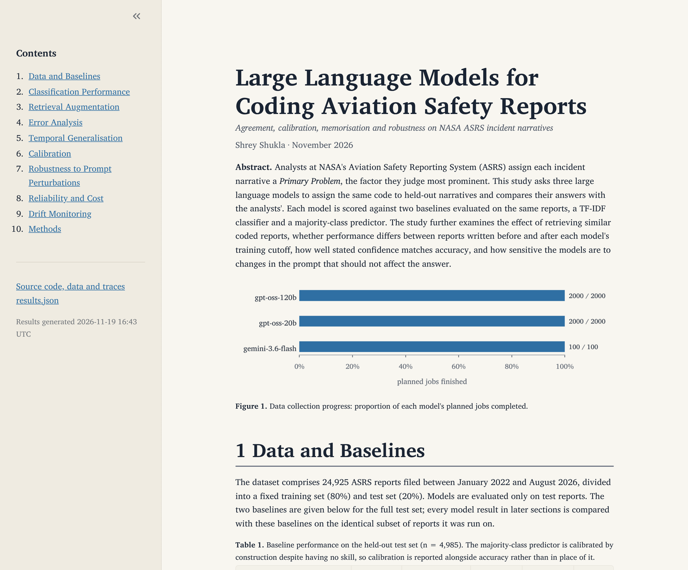
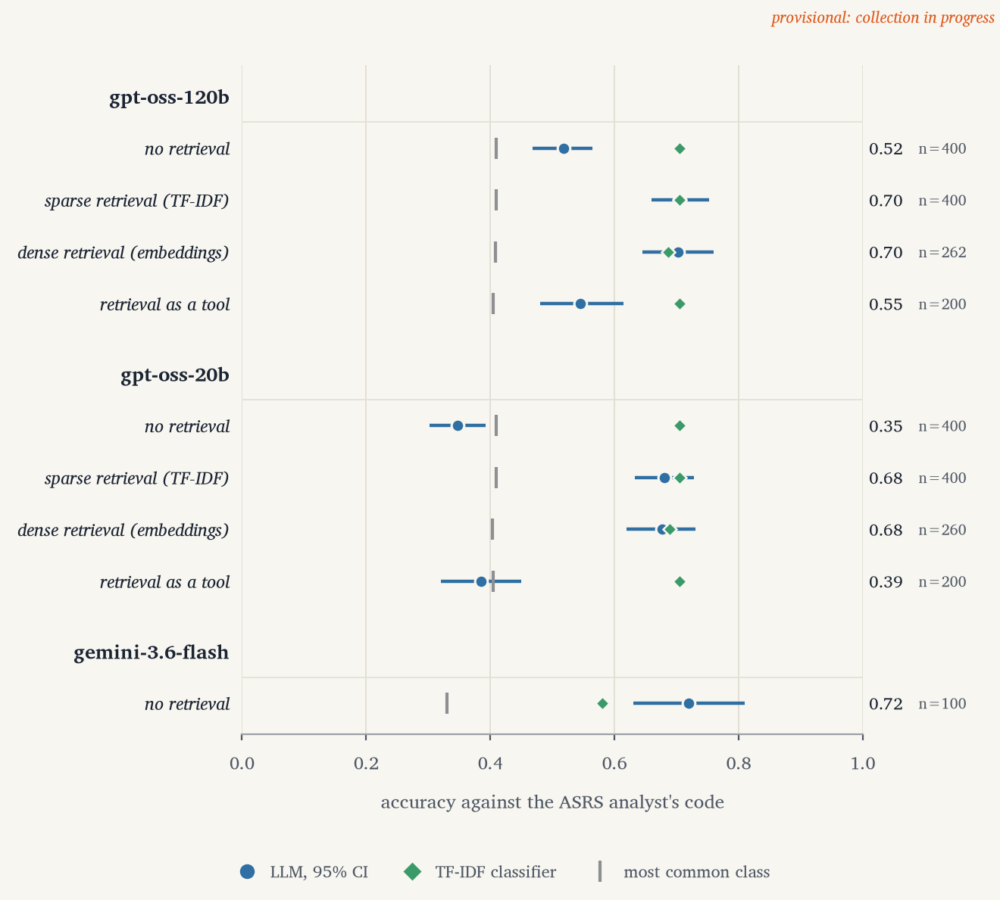
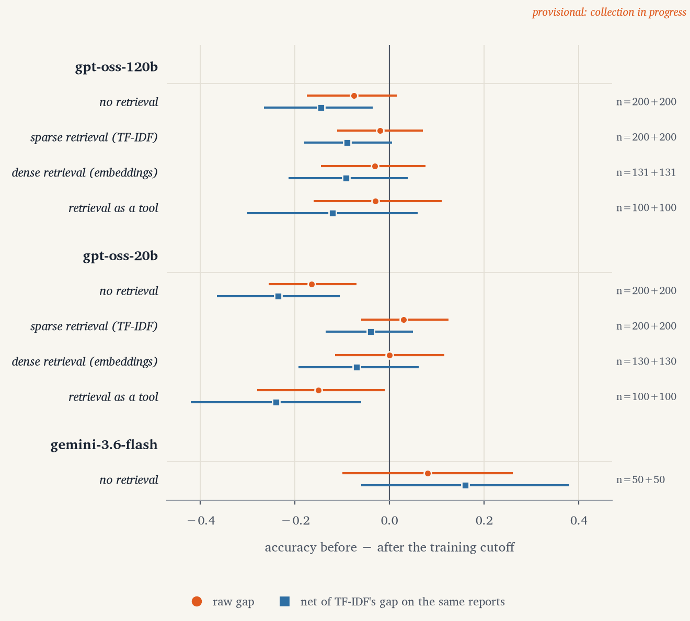
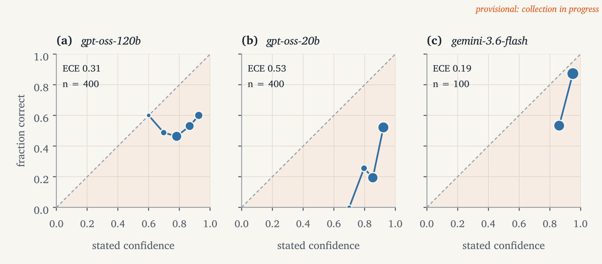
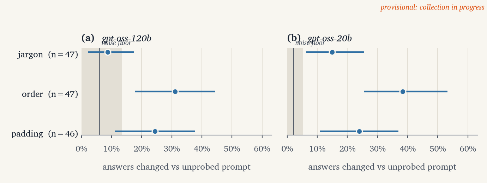

# Large Language Models for Coding Aviation Safety Reports

*Agreement, calibration, memorisation and robustness on NASA ASRS incident narratives*

**Dashboard: [aviation-llm-eval.streamlit.app](https://aviation-llm-eval.streamlit.app/)** ·
results: [`results/results.json`](results/results.json) · every model call:
[`results/traces/`](results/traces/)

[](https://aviation-llm-eval.streamlit.app/)

Analysts at NASA's [Aviation Safety Reporting System](https://asrs.arc.nasa.gov) (ASRS) assign
each confidential incident narrative a **Primary Problem**: the factor they judge most prominent
(Aircraft, Human Factors, Procedure, Weather and 14 others). This project asks three large
language models to assign the same code to 4,985 held-out narratives, and compares every answer
with the analysts' code *and* with two baselines scored on exactly the same reports.

Data collection finished on 17 November 2026 (4,100 model jobs across 9–17 November, on free
API tiers). All numbers below are final, with 95% bootstrap confidence intervals.

## Findings

**1. A word-frequency classifier matches the open-weight models at their best.** Without help,
gpt-oss-120b and gpt-oss-20b agree with the analysts on 51.7% and 34.7% of reports, against
70.5% for TF-IDF + logistic regression on the same reports (differences −0.19 [−0.25, −0.13]
and −0.36 [−0.42, −0.30]). Given five similar coded reports they draw level with it
(120b: +0.000 [−0.048, +0.045]; 20b: −0.025 [−0.072, +0.022]) but do not beat it.
Gemini 3.6 Flash, a closed-weight model run without retrieval, does beat it: 0.72 against 0.58,
+0.14 [+0.04, +0.25].

**2. Retrieval carries most of the performance, largely by teaching the coding scheme.**
Showing five similar training reports adds +0.19 [+0.14, +0.24] for gpt-oss-120b and
+0.33 [+0.28, +0.39] for gpt-oss-20b. Much of the gain comes from correcting one confusion:
without retrieval the models label aircraft faults *Equipment / Tooling*, a category the analysts
use for 0.35% of reports (tools and ground equipment). That single confusion is 19% of
gpt-oss-120b's errors and 30% of gpt-oss-20b's; with retrieval the models' use of the category
falls from 12% and 24% of answers to 1% and 3%.

**3. Offered retrieval as a tool, the models almost never use it.** Given a
`find_similar_reports` function under a neutral prompt, gpt-oss-120b called it on 0 of 200
reports and gpt-oss-20b on 6 of 200, giving up most of the benefit above: −0.17 [−0.24, −0.10]
and −0.30 [−0.38, −0.22] against always retrieving.

**4. Dense embeddings retrieve no better than keyword matching here.** Before any language model
is involved, the share of the five retrieved reports carrying the right code is 0.549 for TF-IDF
and 0.551 for `bge-small` embeddings (paired difference +0.001 [−0.006, +0.008]). Downstream the
two are indistinguishable too: +0.003 [−0.033, +0.037] and +0.007 [−0.028, +0.043] on all 400
reports per model.

**5. No evidence that the gpt-oss models memorised ASRS reports.** Their accuracy is not higher
on reports written before their June 2024 training cutoff; it is lower (adjusted differences
−0.15 [−0.27, −0.04] and −0.24 [−0.37, −0.11]), partly because the earlier sample holds more
*Aircraft* reports (47% against 35%), the category they handle worst. Gemini's lead over TF-IDF
is concentrated in reports from before its cutoff (+0.22 [+0.06, +0.38] before, +0.06
[−0.10, +0.22] after), which is the pattern memorisation would produce, but with 50 reports a
side its adjusted difference (+0.16 [−0.06, +0.38]) is not significant.

**6. The models are confidently wrong.** Without retrieval gpt-oss-120b states a mean confidence
of 0.83 while being right 52% of the time, and gpt-oss-20b 0.88 at 35%: expected calibration
errors of 0.31 and 0.53, against 0.10 for TF-IDF. Retrieval roughly halves them (0.17, 0.23).
Gemini is better calibrated (0.19).

**7. The order of the category list changes a third of the answers.** Reversing the list of
allowed categories changes 28% [19%, 37%] of gpt-oss-120b's answers and 34% [25%, 44%] of
gpt-oss-20b's, against a noise floor (the same prompt asked again) of 6% and 2%. Appending a
paragraph of neutral text changes 22–23% of answers without changing accuracy; a paragraph that
happens to mention category names *raises* gpt-oss-120b's accuracy by +0.11 [+0.04, +0.19],
because it steers answers towards those categories.

## The number to beat

Scored on all 4,985 held-out reports:

| Baseline | Accuracy | Macro-F1 | Cohen's κ | ECE |
|---|---|---|---|---|
| Always "Aircraft" (majority class) | 0.343 [0.330, 0.357] | 0.032 | 0.000 | 0.000* |
| TF-IDF + logistic regression | **0.638 [0.624, 0.651]** | **0.369** | **0.528** | 0.101 |

\*The majority-class predictor states the overall class frequency as its confidence, so it is
perfectly calibrated while having no skill; calibration is read alongside accuracy, never instead.

Each model ran on a different sample of the test set (see Design), so every model result is
compared with both baselines **on exactly the reports that model was run on**. On gpt-oss's 400
main reports TF-IDF scores 0.705; on Gemini's 100 it scores 0.580.

## Results

### Accuracy by model and condition

| | No retrieval | Sparse retrieval | Dense retrieval | Retrieval as a tool | TF-IDF, same reports |
|---|---|---|---|---|---|
| gpt-oss-120b | 0.517 [0.468, 0.565] | 0.705 [0.660, 0.752] | 0.708 [0.662, 0.752] | 0.545 [0.480, 0.615] | 0.705 |
| gpt-oss-20b | 0.347 [0.302, 0.393] | 0.680 [0.632, 0.728] | 0.688 [0.642, 0.735] | 0.385 [0.320, 0.450] | 0.705 |
| gemini-3.6-flash | 0.720 [0.630, 0.810] | – | – | – | 0.580 |

n = 400 per gpt-oss cell (200 for the tool condition), 100 for Gemini. Macro-F1, κ and Brier
scores are in `results.json`.



**Figure 1.** Accuracy by model and condition. Lines are 95% bootstrap CIs; diamonds and ticks
are the TF-IDF and majority-class baselines on the same reports as each row.

### Retrieval

| Paired difference in accuracy | gpt-oss-120b | gpt-oss-20b |
|---|---|---|
| Sparse retrieval − none (n = 400) | +0.188 [+0.138, +0.237] | +0.333 [+0.275, +0.390] |
| Dense retrieval − none (n = 400) | +0.190 [+0.142, +0.237] | +0.340 [+0.280, +0.395] |
| Dense − sparse (n = 400) | +0.003 [−0.033, +0.037] | +0.007 [−0.028, +0.043] |
| Tool − none (n = 200) | +0.025 [−0.025, +0.080] | +0.025 [−0.035, +0.085] |
| Tool − sparse (n = 200) | −0.165 [−0.235, −0.100] | −0.295 [−0.375, −0.220] |
| Tool called | 0 of 200 | 6 of 200 (all 6 correct) |

Retrieval quality without any language model, over all 4,985 test reports
([`results/retrieval_quality.json`](results/retrieval_quality.json)):

| Retriever | Same code among top 5 | 5-nearest-neighbour vote accuracy |
|---|---|---|
| Sparse (TF-IDF) | 0.549 [0.540, 0.559] | 0.644 [0.631, 0.658] |
| Dense (bge-small embeddings) | 0.551 [0.540, 0.560] | 0.635 [0.622, 0.648] |

A five-nearest-neighbour vote alone (0.644) is about as accurate as the trained TF-IDF
classifier (0.638), which is one reason the retrieval-augmented models end up close to it.

### Error analysis

| Without retrieval | Most frequent error (analyst → model) | Share of its errors | Uses *Equipment / Tooling* |
|---|---|---|---|
| gpt-oss-120b | Aircraft → Equipment / Tooling | 19% | 11.7% of answers |
| gpt-oss-20b | Aircraft → Equipment / Tooling | 30% | 24.2% of answers |
| gemini-3.6-flash | Ambiguous → Human Factors | 29% | 0% |
| *Analysts* | | | *0.35% of all reports* |

With sparse retrieval the gpt-oss models use *Equipment / Tooling* for 1.3% and 2.8% of answers.
The second most frequent gpt-oss error, *Aircraft → Human Factors*, is another 11% and 21%.
Gemini's commonest error is assigning a definite cause where the analyst coded *Ambiguous*: it
chose *Ambiguous* once, where the analysts did 11 times. Full confusion lists are under `error_analysis` in
`results.json`.

### Training cutoff and memorisation



**Figure 2.** Accuracy before the training cutoff minus after it. Circles: raw difference.
Squares: net of the TF-IDF baseline's difference on the same reports, which controls for later
reports simply being easier or harder.

| No retrieval | Before cutoff | After cutoff | Raw difference | TF-IDF difference | Adjusted |
|---|---|---|---|---|---|
| gpt-oss-120b (June 2024; 200 + 200) | 0.480 | 0.555 | −0.075 [−0.175, +0.015] | +0.070 | −0.145 [−0.265, −0.035] |
| gpt-oss-20b (June 2024; 200 + 200) | 0.265 | 0.430 | −0.165 [−0.255, −0.070] | +0.070 | −0.235 [−0.365, −0.105] |
| gemini-3.6-flash (Jan 2025 / Mar 2026; 50 + 50) | 0.760 | 0.680 | +0.080 [−0.100, +0.260] | −0.080 | +0.160 [−0.060, +0.380] |

### Calibration



**Figure 3.** Reliability diagrams without retrieval; points sized by the number of reports in
each confidence bin. Points below the diagonal are overconfident.

| ECE (Brier) | No retrieval | Sparse retrieval | Mean stated confidence, no retrieval |
|---|---|---|---|
| gpt-oss-120b | 0.310 (0.346) | 0.167 (0.212) | 0.83 |
| gpt-oss-20b | 0.527 (0.491) | 0.227 (0.253) | 0.88 |
| gemini-3.6-flash | 0.190 (0.225) | – | 0.91 |
| TF-IDF (full test set) | 0.101 (0.203) | | |

### Robustness to prompt perturbations

Each perturbation changes one element of the prompt on the same 100 reports, and is compared with
the **noise floor**: how often asking the identical prompt again gives a different answer
(measured on 20 reports × 10 repeats).

| Answers changed (accuracy change) | gpt-oss-120b | gpt-oss-20b |
|---|---|---|
| Noise floor | 6.0% [0.0, 13.3] | 2.0% [0.0, 5.0] |
| Reversed category order | **28%** [19, 37] (−0.06) | **34%** [25, 44] (−0.05) |
| Neutral padding | **23%** [15, 31] (−0.03) | **22%** [14, 30] (−0.01) |
| Padding that names categories | 19% [11, 27] (**+0.11** [+0.04, +0.19]) | **22%** [14, 31] (+0.04) |
| Abbreviations written out | 8% [3, 13] (+0.03) | 11% [5, 18] (+0.03) |

Bold marks effects whose interval lies wholly above the noise floor's interval, a deliberately
conservative test: gpt-oss-120b's noise floor rests on 20 reports, so its interval is wide.



**Figure 4.** Share of answers changed by each perturbation; the shaded band is the noise floor's
95% interval.

### Reliability and cost

| | Calls | Schema failures | Refusals | Provider errors | Tokens in / out per report | Latency |
|---|---|---|---|---|---|---|
| gpt-oss-120b (Groq) | 2,007 | 0.5% | 0 | 0% | 697 / 90 | 0.73 s |
| gpt-oss-20b (Groq) | 2,000 | 0% | 0 | 0% | 698 / 88 | 0.53 s |
| gemini-3.6-flash (Google) | 109 | 0% | 0 | 3.7% (overload) | 512 / 57 | 9.5 s |

A schema failure is a first reply that does not match the required JSON; every one was corrected
on the single retry, so no answer was scored as a refusal. Gemini was 13–18× slower, and was
returned "high demand" errors on 12 November until the evening (Gemini 3.8 Flash did the same on
9 November, which is why it was replaced). The model name each provider reported never changed.

## Design

### Data

- **24,925 ASRS reports**, every month from January 2022 to August 2026, exported from ASRS
  Database Online in date-window batches (the export caps at 5,000) and de-duplicated on report
  number.
- Frozen in [`data/processed/asrs_reports.csv.gz`](data/processed/asrs_reports.csv.gz) with a
  fixed, stratified 80/20 train/test split (19,940 / 4,985). Models are only evaluated on test
  reports; retrieval and the TF-IDF baseline only use training reports.
- Target: Primary Problem. Categories with fewer than 30 reports are merged into *Other*
  (16 classes). The models choose from all 18 ASRS values and the same merge is applied to their
  answers.

### Models and training cutoffs

| Model | Provider | Training cutoff | Source |
|---|---|---|---|
| gpt-oss-120b | Groq | June 2024 | [Model card, §2.4](https://arxiv.org/html/2508.10925): *"Our model has a knowledge cutoff of June 2024."* |
| gpt-oss-20b | Groq | June 2024 | Same model card |
| gemini-3.6-flash | Google | March 2026, "limited to January 2025" in some domains | [Model card](https://deepmind.google/models/model-cards/gemini-3-6-flash/) |

Because Gemini's card gives two dates, reports from January 2025 to March 2026 are not sampled for
it: "before" is before January 2025 and "after" is April 2026 onwards. Its free tier allows 20
requests a day, so it ran the memorisation comparison only, without retrieval.

### Experiments

The job list was frozen before any model call ([`results/plan.json`](results/plan.json); 4,100
jobs). Additions after review were appended without changing any existing job, run on the same
reports, and are logged in the plan file.

| | gpt-oss-120b, gpt-oss-20b | gemini-3.6-flash |
|---|---|---|
| Main: 200 reports before + 200 after cutoff, with and without sparse retrieval | 800 each | – |
| Noise floor: 20 reports × 10 identical repeats | 200 each | – |
| Perturbations: abbreviations, category order, padding × 100 reports | 300 each | – |
| Memorisation: 50 before + 50 after, no retrieval | – | 100 |
| *Added 10 Nov:* dense retrieval, same 400 reports | 400 each | – |
| *Added 10 Nov:* retrieval as a tool, first 200 reports | 200 each | – |
| *Added 16 Nov:* neutral padding, same 100 reports | 100 each | – |

- **Retrieval** shows the five nearest training reports as their one-line synopsis and the
  analyst's code. *Sparse*: TF-IDF cosine similarity. *Dense*:
  [`BAAI/bge-small-en-v1.5`](https://huggingface.co/BAAI/bge-small-en-v1.5) embeddings (revision
  `5c38ec7`), exact cosine search over ~20,000 vectors; neighbours are precomputed by
  [`scripts/build_dense_index.py`](scripts/build_dense_index.py) so CI and Docker never load the
  model. *Tool*: the model may call `find_similar_reports(k)`, which returns exactly what sparse
  retrieval shows; the only difference is the model's choice.
- **Perturbations** change one thing each. The neutral padding is checked by a test to contain no
  category word and is within 10% of the length of the original padding.

### Scoring rules (fixed before the results; embedded in `results.json`)

- A **refusal** (reply fails the schema twice, the second time with the error returned to the
  model) counts as wrong in accuracy and is excluded from calibration.
- **Provider errors** (overload, quota) are not results; those jobs were retried on later days and
  the error rate is reported as availability.
- **Memorisation** = accuracy before cutoff − accuracy after (different reports: unpaired
  bootstrap), minus the same difference for TF-IDF on the same reports.
- **Condition and perturbation effects** compare the same reports (paired bootstrap).
- All intervals are 95% percentile bootstrap intervals, 2,000 resamples, seed 42.

## Changes made during the study

Recorded here because each one changes what a number means, and each is visible in the commit
history.

| Date | Change | Why |
|---|---|---|
| 9 Nov | Gemini 3.8 Flash replaced by 3.6 Flash before any job ran | 3.8 returned repeated "high demand" errors; 3.6's model card states the same cutoff |
| 10 Nov | Gemini sample cut from 200 to 50 reports a side, after 14 jobs | Free-tier schedule; the kept sample is the first 100 jobs of the original plan, so nothing was re-sampled |
| 10 Nov | TF-IDF baseline refitted to convergence: 0.636 → 0.638 | The Docker reproducibility check caught 29 predictions depending on machine-level rounding |
| 10 Nov, 14 Nov | Provider rejections of malformed model output (`json_validate_failed`, `tool_use_failed`) treated as the model's schema failures, not outages | Otherwise those reports would never be scored, quietly excluding the model's worst cases |
| 10–11 Nov | Dense-retrieval and tool conditions added, then interleaved with remaining jobs | Reviewer request; interleaving runs conditions on the same days so provider drift cannot pose as a condition effect |
| 16 Nov | Original padding relabelled "padding that names categories"; neutral padding added | The original text named four categories and steered answers towards *Aircraft* |

## How it runs

```
schema.py    Pydantic model for every answer: category, confidence in [0, 1], reason
providers.py one OpenAI-compatible client for Groq and Gemini, with backoff on 429/5xx
retrieve.py  sparse (TF-IDF) and dense (precomputed embedding) retrieval, training set only
agent.py     retrieve -> classify -> validate -> one retry with the error -> refusal;
             the tool-calling loop for the tool condition
probes.py    the prompt perturbations
runner.py    frozen plan, per-model daily budgets in each provider's quota day,
             JSONL trace of every call, resumable
report.py    results.json; charts.py the figures; app/dashboard.py the dashboard
```

| Workflow | Schedule | Purpose |
|---|---|---|
| [`tests.yml`](.github/workflows/tests.yml) | every push | 91 tests; builds the Docker image on a clean machine and checks the rebuilt baselines match the committed numbers within 0.002 |
| [`daily.yml`](.github/workflows/daily.yml) | every 3 hours | Collection within each model's free quota (complete; now finds nothing to do) |
| [`weekly.yml`](.github/workflows/weekly.yml) | Sundays | Drift monitoring: re-asks a fixed panel (40 reports per gpt-oss model, 15 for Gemini) and flags answers changing beyond the noise floor or a new model version |
| [`keepalive.yml`](.github/workflows/keepalive.yml) | every 2 hours | Opens the dashboard in a headless browser and wakes it if Streamlit has put it to sleep |

## Reproduce

With Docker, rebuilding the baselines, `results.json` and every figure from the committed data
and traces (no API keys needed):

```bash
docker build -t asrs-llm-eval .
docker run --rm -v "$PWD/results:/app/results" asrs-llm-eval
```

Or locally:

```bash
git clone https://github.com/hydrograd/asrs-llm-eval && cd asrs-llm-eval
pip install -r requirements.lock && pip install --no-deps -e .
pytest                                   # no network or keys needed
python scripts/run_baselines.py          # baselines from the frozen dataset
python scripts/make_report.py            # results.json and figures from the committed traces
streamlit run app/dashboard.py
```

Re-running models needs `GROQ_API_KEY` and `GEMINI_API_KEY`; see
[`scripts/run_experiment.py`](scripts/run_experiment.py). The metrics are tested against
hand-worked examples with each expected value derived beside it
([`tests/test_metrics.py`](tests/test_metrics.py)).

## Limitations

What these results do not show:

- **Agreement is not correctness.** The reference is one analyst's code. ASRS publishes no
  inter-coder agreement, so there is no human ceiling, and some "errors" may be defensible
  readings. Gemini's commonest error, naming a cause where the analyst chose *Ambiguous*, is
  arguably of that kind.
- **The models were not given the ASRS coding manual**, only the category names. Their largest
  error (Finding 2) is a misreading of what one category covers; with the manual's definitions
  their unaided accuracy would likely be higher. The taxonomy document ASRS publishes lists names
  only.
- **Confidence is self-reported.** The models write their confidence as a number in the reply;
  it is not derived from the model's internal probabilities, as TF-IDF's is. The calibration
  results describe the confidence the models *state*, which is what a user would see.
- **One prompt.** Results are for one wording. Reversing the category order alone changes about
  a third of the answers (Finding 7), so other reasonable prompts could give materially different
  accuracies.
- **Three models, two from one family.** The tool and retrieval findings come from the two gpt-oss
  models only; Gemini ran without retrieval on 100 reports.
- **The tool result is for a neutral prompt.** The tool was neither encouraged nor required. The
  base prompt's "Reply with only a JSON object" had to be reworded for this condition because it
  stopped both models from considering the tool at all. In an informal check, prompts that told
  the model to use the tool got it called every time; that was not a measured condition.
- **The memorisation test is weak in both directions.** The adjustment assumes later reports are
  harder for TF-IDF in the same way as for the models; a shift in category mix breaks that
  (Finding 5). Gemini's sample is 50 reports a side, so differences under about ±0.2 cannot be
  detected. A null result means no effect larger than the interval, not no effect.
- **Recent months are thin.** NASA's processing lag leaves July and August 2026 with 332 and 40
  reports, the ones processed fastest; they are part of Gemini's "after" sample.
- **Text length.** Narratives over 500 words are cut for the model (8.9% of reports) and only the
  first reporter's narrative is used. Sparse retrieval reads the full narrative and dense
  retrieval its first 512 tokens (13.4% cut), so on long reports the retrievers see slightly
  different text from the model and from each other.
- **One small embedding model.** "Dense equals sparse" is for `bge-small-en-v1.5`; a larger or
  domain-tuned model might retrieve better.
- **Drift detection has a blind spot.** The weekly monitor flags a change in the reported model
  name or in answers beyond the noise floor. Groq's backend fingerprint took 54 and 36 distinct
  values for the two gpt-oss models during collection, so it cannot serve as a version signal,
  and Gemini reports none. A silent model update that leaves answers on the 40-report panel
  within the noise floor would go undetected.
- **The noise floor rests on 20 reports.** Its interval is wide, especially for gpt-oss-120b
  (0–13%), so the test of whether a perturbation exceeds it is conservative.
- **Temperature 0 is not deterministic** on these APIs; the noise floor measures by how much.

## Data

ASRS data is published by NASA. The processed file here is derived from ASRS Database Online
exports and keeps only the report number, month, synopsis, narrative and Primary Problem.
